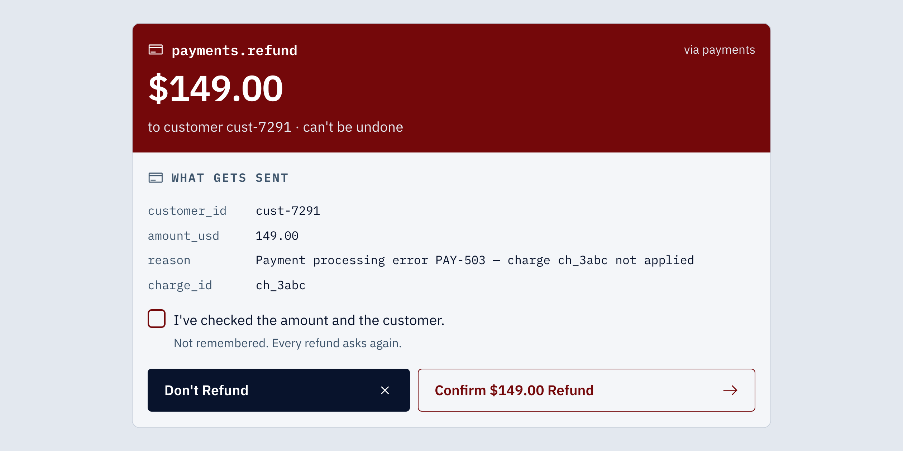

# MCP Consent Moment

Consent sized to the risk, asked at the moment of use.

**Live demo:** https://mcp-consent-moment.vercel.app



## The problem

Agents move fast. People decide slowly. An agent calls tools at machine speed, and a person makes trust decisions at human speed.

Most hosts ask for one permission when a server connects. That single grant treats a read and an irreversible refund the same way, and it asks before the person knows what they are deciding. Consent has to happen at the moment of use, sized to the risk.

## Five theses

1. Defer the grant to first meaningful use, not connection.
2. Tier by risk, not by tool.
3. The tool schema is the consent payload.
4. Consent is a budget, not a switch.
5. The system matches the human to the right tempo.

The thesis strip under the top bar lights the theses each step demonstrates.

## The tier system

READ → WRITE → SCOPE CREEP → DESTRUCTIVE. The card gets heavier and warmer as the stakes rise, from a gray hairline to a 1.5px slate frame, a 2px terracotta frame, and a film-red header panel.

Risk changes structure, not just color, so the tiers still read in grayscale.

- **Read** passes quietly. It shows up in the activity sidebar after it runs.
- **Write** shows a draft of exactly what will be written. The draft turns solid and takes its real ID once the tool runs.
- **Scope creep** shows exactly what's new: the fields the server already holds, where that grant ends, and each new field with its own checkbox.
- **Destructive** gets a hard stop. The amount is the largest thing on the card, a review checkbox is required, and Confirm only goes live after a deliberate pause. It is never remembered.

## The causal trace

One vertical trace shows what's granted (forest line and nodes), where the grant ends (dashed terracotta), what's new (terracotta-outlined nodes), and any cross-server hop (a dashed rule labeled "crosses to payments · not granted"). Every node carries its server label.

The completion receipt reuses the same trace as a record of what you decided.

## Five scenarios

- **Happy path:** every consent granted; the task completes end to end.
- **Partial completion:** deny the refund; the agent notes it on the ticket and ends on "2 of 3 done."
- **Scope creep:** keep the current grant; the agent writes the 3 granted fields and leaves assignee and labels for you.
- **Tool error:** the refund fails twice; you choose Skip for Now or Try Refund Again.
- **Multi-hop:** a CRM email change would also change 2 fields on payments, a server you haven't granted; cross-server changes ask every time.

## Behavior

- The agent waits at every gate. Nothing runs while a card is open, and there are no timeouts.
- Narrow is the default. Focus lands on the primary action, which is always the smallest scope that still does the task.
- Enter takes the primary action. Escape takes the safe choice: Deny, Keep Current Grant, Don't Refund, Skip for Now, or Change CRM Only.
- No keyboard shortcut broadens scope or confirms a destructive action.
- Destructive actions have a deliberate beat. Confirm goes live after 600ms and needs the review checkbox. An early click shows "Check the amount first." and the button is never disabled. Repeat clicks are ignored for 1s.
- Stop always works: one click, no modal, confirmed in place with "Agent stopped. Nothing else will run."
- Grants appear only after the decision. Revoke is immediate, and the next use asks again.
- Reduced motion is supported. Nothing moves, draws or types; opacity fades keep their token durations.

## The token contract

[docs/design/tokens.json](docs/design/tokens.json) is the single source for every color, border width, font, size, space, radius, opacity and duration. It follows the DTCG format. Space uses Nathan Curtis's inset, stack and inline concepts. A small script ([demo/scripts/build-tokens.mjs](demo/scripts/build-tokens.mjs)) generates the CSS custom properties, and components read only those variables.

The Figma file holds the same tokens as variables, at parity with code: 167 tokens, zero diff.

The design decisions behind the tokens are in [docs/design/](docs/design/): theme, screens, and behavior and motion.

## How it was built

A designed system, a token contract and human review, not one autonomous session. The design system was locked first. Claude Code built against it phase by phase, checked each screen against docs/design/, and logged what it caught. Designed and specified by Jonathan Hargrove, who reviewed and approved the work.

- Code came first. The Figma system was generated from code: tokens as variables, components as components, and the screens built from them.
- The multi-hop card was designed in Figma first and built from the Figma frames into code.
- Every catch is in the [review log](docs/design/review-log.md): what was wrong, the rule, the fix.

Figma shots:

- [Variables](docs/case-study/figma-1-variables.png)
- [Button component properties](docs/case-study/figma-2-button-properties.png)
- [Auto layout](docs/case-study/figma-3-auto-layout.png)
- [Multi-hop card, Figma next to code](docs/case-study/multihop-figma-vs-code.png)

## Verification

104 browser checks, run with motion on and with reduced motion on: the Nov 2 suite (57 checks of copy, colors, tiers, remember, revoke, stop and receipts) and the Phase 5 suite (47 checks of focus, keys, deliberate beat, double-commit guard, motion and all five scenarios).

```
cd demo && npm test
```

The first run needs Playwright's Chromium: `cd demo && npx playwright install chromium`.

## Run locally

```
cd demo
npm install
npm run dev
```

The demo is Vite and React. `npm run dev` regenerates the token CSS from tokens.json first. The component gallery is at `/gallery.html`.

## Repo layout

```
packages/
  consent-core/    framework-agnostic consent state machine: gate(), budget, risk tiers, scope-creep detection
  consent-react/   useConsentGate, the design-system components, styles.css, motion helpers
demo/              Vite + React demo: host shell, mock MCP servers, scripted agent, the cards
tests/             the two browser check suites and their runner
docs/
  design/          tokens.json and the theme, screen and behavior decisions, review log
  case-study/      hero shot and Figma shots
  a-consent-pattern-for-mcp.md   the pattern, written up for hosts
```

The MCP servers and the agent are simulated: in-app servers with real MCP-shaped schemas and a scripted, deterministic agent. The consent state machine and the UI are real.
